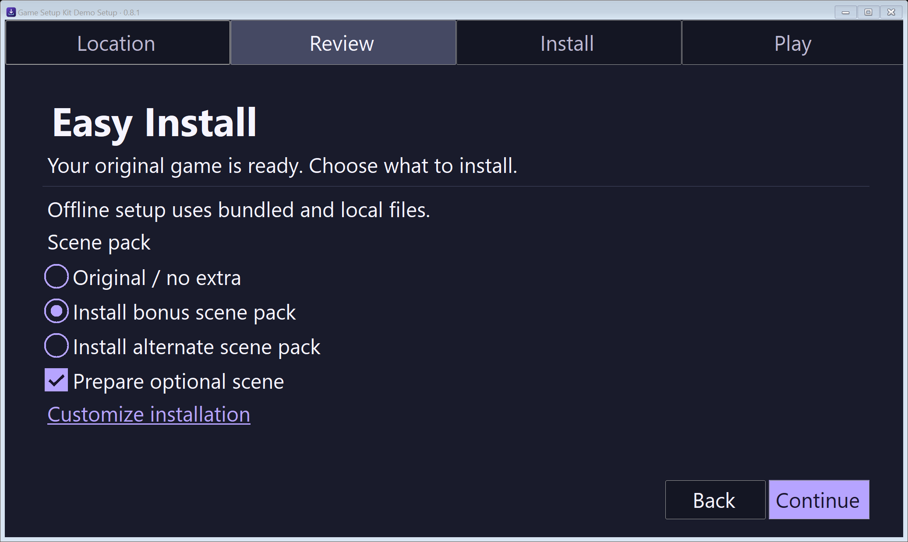
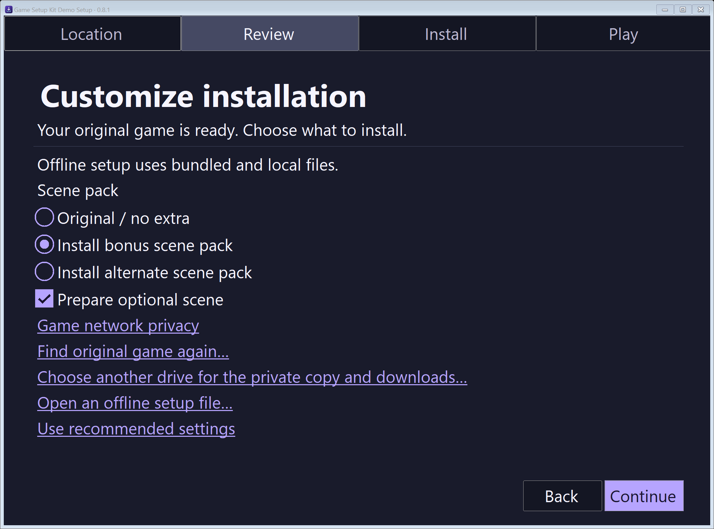
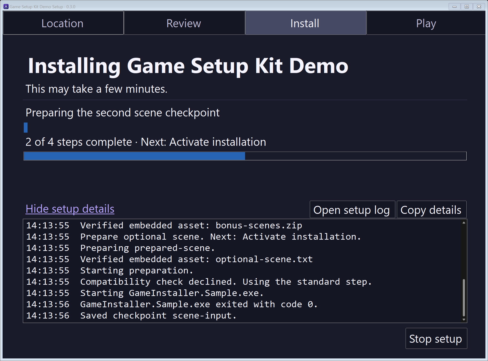
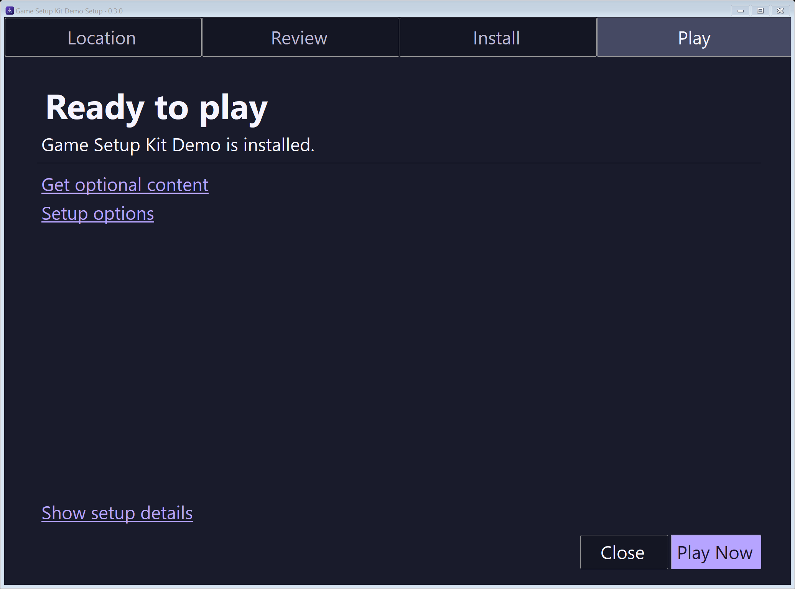

# Game Setup Kit

A guided Windows installer that game and mod makers can adapt for their projects. Try it with a small demo game included in the download.

**[Try the Windows demo](https://github.com/goodtripgoodtip/GameSetupKit/releases/download/v0.8.1/GameSetupKit-Windows-Demo-Offline-v0.8.1.zip)** · [Version 0.8.1 downloads](https://github.com/goodtripgoodtip/GameSetupKit/releases/tag/v0.8.1) · [Player guide](docs/Players.md)

## Try it on Windows 11

1. Download the demo ZIP. Right-click it and choose **Extract All**.
2. Open the extracted folder and double-click **GameSetupKit-Demo-Setup-Offline.exe**.
3. Choose **Continue**, review the choices and terms, then choose **Install**. When setup finishes, choose **Play Now**.

The demo works offline and comes with its own example files. For an actual mod, use the setup package from the mod maker. You’ll need your own supported copy of the original game.

## See how setup works

**Customize installation** lets you choose what to include.

**Show setup details** opens a live activity log. You can follow progress or copy details if you need help.

**Play Now** starts the demo after setup. Open **Setup options** to manage or remove the demo later.

## For developers

Open `GameInstaller.slnx` in Visual Studio 2026 with the .NET desktop development workload and .NET 10 SDK. Run the **Private-copy mod sample** or **Standalone game sample** launch profile. [Microsoft prerequisites](https://learn.microsoft.com/en-us/dotnet/desktop/winforms/get-started/create-app-visual-studio)

- [Integration guide](docs/Integration.md) covers the C# API, downloads, packaging, logging, and setup customization.
- [NeonLoop comparison](docs/NeonLoop.md) shows how the original mod installer workflow maps to the shared API.
- [Build and verification](docs/Release.md) covers the standard and offline builds and the local sample checks.

Built by [Good Trip Good Tip](https://github.com/goodtripgoodtip), an ex game dev with 30 years in the industry, with [OpenAI Codex](https://github.com/openai/codex) as an AI co-developer. [OpenAI](https://github.com/openai) · [MIT License](LICENSE) · [Hobby Release Terms](HOBBY-TERMS.txt)
